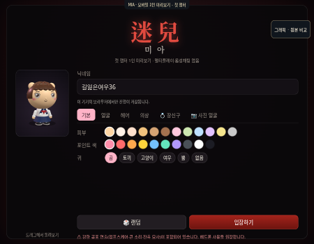
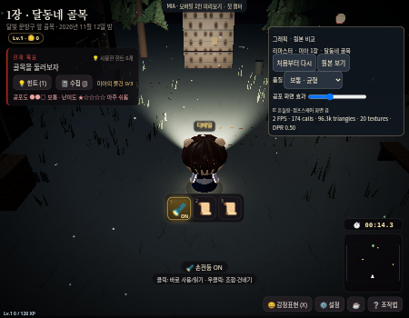
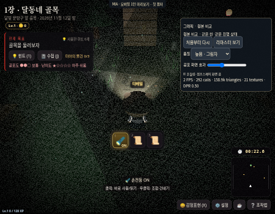

# 모바일 캐릭터·배경 디테일 업그레이드

이번 변경은 사용자가 승인한 모바일 1인 미리보기에만 적용합니다. 공유 public/js/avatar.js, world.js, props.js와 운영 엔진/챕터 데이터는 수정하지 않았습니다. mobile/build.mjs가 생성하는 복사본에서만 추가 모듈을 연결합니다.

## 구현

- 캐릭터: 기존 큰 머리/짧은 몸 비율과 얼굴 텍스처·눈 깜빡임·감정표현 유지. 곡선 튜브로 머릿결/뒷머리 볼륨, 작은 입체 코, 둥근 옷깃·포켓·옷 주름·봉제선과 직물 노멀맵을 추가. 원래 머리/상체/팔 관절 아래에 붙여 기존 애니메이션을 따릅니다.
- 배경: 기존 나무 위치를 유지하고 원뿔 덩어리 대신 가지·줄기 및 직접 그린 바늘잎 알파 카드로 표현. 나무 전체를 두 InstancedMesh로 묶습니다. 카메라와 플레이어 사이 나무는 시야를 확보하도록 일시 숨깁니다.
- 기존 건물 외벽: 벽돌 표면/요철, 실제 창틀·창문 가로대·문틀·홈통·지붕 타일 추가. 건물·출입구·이동 경로와 충돌 정보는 그대로입니다.
- 바닥: 균열/입자 무늬의 포장 표면과 요철, 기존 잔디 인스턴스 자리에 휘어진 잎을 사용. 추가 공간/퍼즐/상호작용 대상 없음.
- 기본 카메라 거리 10→6.5로 가까이 조정. 기존 드래그/핀치/카메라 충돌 기능 유지.
- 낮음에서도 기본 입체 머릿결·코·옷 주름·창틀·자연스러운 나무가 보입니다. 보통/높음에서 세밀한 봉제선과 지붕 타일을 추가합니다. 기존 DPR/그림자 옵션은 유지합니다.
- 원본 비교 시 새 캐릭터 재질/장식과 새 배경을 복구할 수 있도록 전환합니다. 아바타 교체 때 추가 GPU 자원을 해제합니다.

새 외부 모델/이미지 사용 없음. 추가 절차 모델·텍스처는 직접 작성했습니다. RoundedBoxGeometry와 mergeGeometries는 Three.js MIT 라이선스에 포함됩니다.

## 검증

Chromium 소프트웨어 렌더링에서 3단계 품질 전환, 아바타/월드 업그레이드 활성화, 원본 비교 시 복원, 동일 콜라이더를 확인했습니다. 이 검증에서 브라우저 오류는 없었습니다. 실제 휴대폰 GPU 성능이나 목표 30/60FPS 달성을 검증한 결과는 아닙니다.

| 모드 | 활성 월드 메시 수 | 월드 삼각형 수 |
|---|---:|---:|
| 원본 | 161 | 13,188 |
| low | 117 | 36,395 |
| medium | 123 | 43,241 |
| high | 123 | 43,241 |

위 값은 씬의 visible 월드 메시/기하를 세며, 인스턴스 배치는 메시 하나로 셉니다. 실제 GPU draw call, frustum culling 후 수치 또는 FPS 개선률이 아닙니다. 형태를 풍부하게 하면서 나무 배치를 묶어 메시 수를 줄인 결과입니다. 소프트웨어 환경의 짧은 FPS 표본은 대략 2FPS로 실제 모바일 성능을 대표하지 않습니다.

확인용 시각 검증: 로컬 정적 서버를 먼저 실행한 뒤 `CHROMIUM_PATH=/usr/bin/chromium node preview/mobile/visual-test.mjs` (다른 주소는 VISUAL_TEST_URL 환경변수). 기존 모바일 전체 플레이 검증은 `node preview/mobile/test.mjs <생성 사이트 경로>`를 사용합니다.

[시각 검증 기록](detail-v2/results.json)

전체 모바일 회귀 검증도 최종 소스에서 모두 통과했습니다: 터치 이동/손전등, 숫자판 퍼즐, 유품·단서, 새로고침 복원, 가로 화면, 완료·재시작, 오류/외부 요청 없음.
