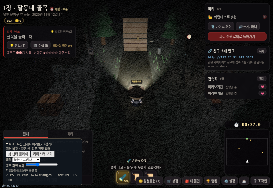
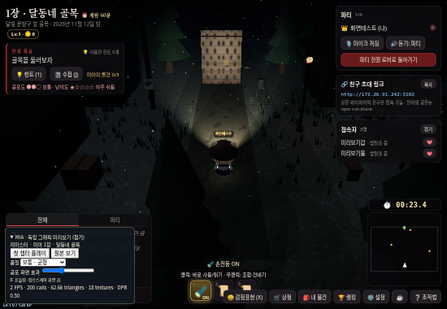

# 그래픽 미리보기 검증 기록

검증일: 2026-11-15. 상세 실행 방법은 [가이드](GRAPHICS-PREVIEW.md)를 참고하세요.

## 환경 및 범위

Linux 컨테이너, Node.js 24, Chromium headless / SwiftShader 소프트웨어 렌더링. 일반 PC 또는 저사양 PC의 물리 GPU로 측정한 결과가 아닙니다. Windows 배치, Docker 및 외부 호스팅은 실행 검증하지 않았습니다. 기존 게임은 ES modules을 브라우저에 직접 제공하므로 번들 빌드 단계가 없습니다.

## 자동 검증

- `npm ci --cache /tmp/mia-npm-cache --no-audit --no-fund`: 루트 잠금파일로 의존성 설치 완료. 최초 기본 캐시 경로는 환경의 쓰기 제한으로 실패하여 쓰기 가능한 캐시로 재시도했습니다.
- `npm run preview:check`: 클라이언트·서버·미리보기 JavaScript 구문 검사.
- `npm test --prefix preview`: 별도 로컬 서버, 두 Socket.IO 클라이언트, 실제 Chromium 렌더링 테스트. 전체 결과와 측정은 아래 최종 실행 기록에 기재합니다.

게임 데이터·귀신 AI·서버 퍼즐 판정·아이템 규칙·월드 충돌 생성 코드는 수정하지 않았습니다. 이것만으로 모든 기존 챕터를 완주 검증했다고 볼 수는 없습니다.

## 남은 수동 검증

- 사용자 PC의 실제 GPU에서 낮음/보통/높음 각 5분 이상 플레이하여 FPS·발열·입력 반응 확인. 일반 PC 60FPS / 저사양 30FPS 목표는 아직 달성 검증하지 않았습니다.
- Windows 실행 배치와 방화벽/LAN 다중 PC 연결.
- 실제 마이크/WebRTC 음성 송수신, 헤드폰 출력 및 원격 네트워크 연결. 신호 중계 검증은 음성 매체 송수신 검증과 다릅니다.
- 전체 테마 완주, 모든 점프스케어와 귀신 추격/정지/텔레포트, 모든 아이템 조합 및 세션 재접속의 수동 회귀 테스트.
- 장시간 GPU 메모리 누수/브라우저별 차이/모바일 GPU. texture/geometry 수는 관찰 가능한 객체 수이며 GPU 바이트가 아닙니다.
- 접근성: 화면 효과 0 설정과 공포도 0/1 설정을 실제 사용자가 평가. 다른 챕터는 원래 공포 연출을 사용합니다.
- Docker 빌드 및 온라인 서비스 배포는 미실행. 온라인 URL 없음. 배포는 별도 승인 필요.

## 최종 실행 결과

최종 자동 검증은 모두 통과했습니다. 브라우저 JavaScript/console 오류 및 외부 에셋 네트워크 요청은 없었습니다.

- 통과: Isolated server: ignores production DB/public URL, local assets/fonts
- 통과: Two clients: party/start, position and animation sync, voice signaling relay
- 통과: Poster, flashlight reveal, relic pickup, wrong/correct lock and chapter transition sync
- 통과: Existing ghost activation and movement (engine test; first chapter has no chase AI)
- 통과: Browser: first scene, keyboard movement, camera control, offline assets
- 통과: Three quality levels, original/remaster toggle, unchanged colliders/object IDs, effects slider
- 통과: Browser: actual chapter progression restores original rendering in chapter two
- 통과: No browser JavaScript/console errors or external network asset requests

두 클라이언트는 프로토콜 기반 자동 플레이로 퍼즐·아이템·챕터 전환을 검증했고, Chromium에서는 실제 키 입력 이동·카메라 정렬·손전등·품질 전환·씬 생성과 다음 챕터 복원을 검증했습니다. 전체 수동 플레이나 모든 퍼즐 UI 조작 검증은 아닙니다. 비교 토글 반복 후 texture 수가 증가하지 않았고 콜라이더/오브젝트 식별자가 동일함을 확인했습니다. 대상 판정은 미아 id 0만 참이며 미아 id 1/귀문 id 0은 거짓입니다.

| 품질 | 짧은 FPS 표본 | 렌더 calls / triangles | textures / geometries | DPR | 그림자 |
|---|---|---|---|---|---|
| low | 2 FPS | 196 calls / 62.6k triangles | 18 / 107 | 0.5 | 꺼짐 |
| medium | 2 FPS | 200 calls / 62.6k triangles | 18 / 108 | 0.5 | 꺼짐 |
| high | 1 FPS | 295 calls / 110.1k triangles | 19 / 108 | 0.5 | 켜짐 |

1100×760 CSS viewport, deviceScaleFactor 0.5의 headless 소프트웨어 렌더링에서 HUD의 짧은 표본을 읽었습니다. 평균/백분위 성능 측정이 아니며 실제 GPU 성능을 대표하지 않습니다. 이 환경에서는 30/60FPS 목표를 충족하지 못했습니다. 품질별 표본은 연속 시점이고 조명·그림자 패스 차이가 있으므로 작은 FPS 차이를 성능 향상률로 해석하지 않습니다.

[자동 검증 원본 결과](preview-captures/results.json)

원본 / 리마스터 보통 (동일 씬·카메라·진행, 손전등 켬):

[낮음 화면](preview-captures/remaster-low.png) · [높음 화면](preview-captures/remaster-high.png)

## 운영 보호 및 전달 상태

작업은 로컬 preview/graphics-remaster-ch1 브랜치에 저장했습니다. main에 커밋/병합하지 않았고 기존 배포 설정·서비스 URL·운영 DB 및 챕터 데이터는 변경하지 않았습니다. 온라인 배포는 수행하지 않았습니다.

원격 업로드는 Git push와 GitHub 연결 앱의 브랜치 생성 모두 실제 403 권한 오류로 차단됐습니다. 따라서 원격 브랜치나 PR이 생성됐다고 보고하지 않습니다. 코드·PR 본문·로컬 소스 ZIP·Git bundle로 결과물을 보존하며 앱 쓰기 권한이 허용되면 업로드/초안 PR 생성이 남습니다.
