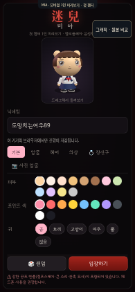
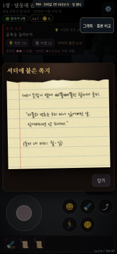

# 머리카락 원복 및 글꼴 복원

추가한 곡선 머릿결/뒷머리 메시와 머리 재질 보정을 제거했습니다. 원래 헤어스타일 9종의 형상·변환·거칠기가 원본 avatar.js와 일치하는지 브라우저에서 검증했습니다. 코·의상·배경 디테일은 유지합니다.

문서 CSS와 원래 글꼴 이름은 바뀌지 않았으나, 미리보기에서 외부 Google Fonts 요청을 제거하면서 기기 기본 폰트로 대체되고 있었습니다. 원래 5개 글꼴/7개 굵기의 글꼴 파일을 로컬 WOFF2로 포함했습니다. 원본 UI/쪽지 스타일 CSS는 수정하지 않았습니다. 쪽지는 Nanum Pen Script, 모바일 원래 크기인 21px로 표시됩니다. 오프라인 PC 미리보기에서도 같은 파일을 제공하며, 일반 운영 실행 경로는 바꾸지 않았습니다.

- 통과: 기존 머리 9종의 원본 형상/재질 일치
- 통과: 원래 글꼴 7종 실제 로드, 외부 폰트 요청 없음
- 통과: 실제 셔터 쪽지에서 손글씨체 및 원래 모바일 크기 확인
- 통과: 브라우저 오류/외부 요청 없음
- 통과: 별도 PC 미리보기 서버의 폰트 CSS 및 WOFF2 응답

원본 글꼴 라이선스·출처·재현 방법: preview/mobile/fonts/README.md, sources.json 및 각 OFL.txt.

[검증 기록](hair-font-restoration/results.json)
