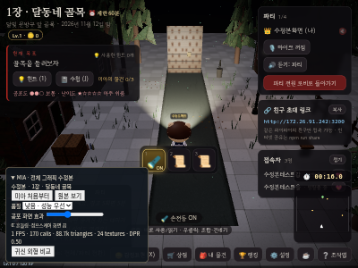
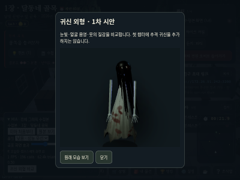

# 전체 수정본 검증 결과

검증일: 2026-11-15. Linux/Node 24/Chromium headless/SwiftShader. 실제 Windows/모바일 GPU 환경은 아닙니다.

## 수행 및 통과

- 11개 테마, 58개 챕터 모두 기존 데이터로 씬 생성 및 원본 world.update 호출.
- 58개 챕터 모두 저해상도(128×96)에서 실제 WebGL 1프레임 렌더링. 모델/재질/셰이더 실행 검증이며 장시간 플레이/성능 검증은 아님.
- 모든 씬에서 그래픽 적용/원본 비교 전후 콜라이더와 오브젝트 식별자 동일.
- 테마 고유 안개 색 유지, 정전 챕터의 천장 조명 꺼짐 유지.
- 첫 골목의 도로/주변 바닥 이미지가 서로 다름을 검증.
- 실제 챕터에서 사용하는 귀신 21종의 배회/추격 애니메이션 실행 및 변환값 정상 확인. 기존 서버 AI 데이터·속도·감지·잡기 판정은 변경 없음.
- 통과: Two clients join/start the same instance
- 통과: Position and animation sync
- 통과: Flashlight clue and item acquisition
- 통과: Wrong/correct lock answers synchronized
- 통과: Chapter advance in multiplayer
- 통과: Original voice signaling relay
- 통과: Actual full client movement
- 통과: Three presets and original comparison in actual full client
- 통과: Ghost appearance preview opens, compares and disposes
- 브라우저 JavaScript/console 오류 없음.
- JavaScript 구문 검사 통과. 기존 프로젝트는 native ES modules이므로 별도 번들러 빌드는 없음.
- 공개 운영 파일 23개 읽기 전용 백업: 모두 GitHub main과 바이트 일치. 운영 서비스/DB/설정 변경 없음.

## 미검증 및 한계

- 모든 챕터를 끝까지 수동 완주하거나 모든 퍼즐 유형/점프스케어/이벤트를 재현한 것은 아닙니다. 네트워크 퍼즐 검증은 첫 미아 챕터의 단서·유품·자물쇠·다음 챕터 전환에 집중했습니다.
- 마이크 실송수신, 서로 다른 PC/원격 NAT, Windows 배치의 실제 Windows 실행, Docker 빌드 및 외부 호스팅은 미검증입니다.
- 실제 PC 60FPS/저사양 30FPS 목표는 미검증입니다. 테스트 환경의 저해상도 셰이더 검증을 실기기 성능 달성으로 해석하지 마세요.
- 장시간 GPU/메모리/발열과 전 테마의 최종 미술 품질은 실제 기기에서 확인해야 합니다.
- 원본 백업은 코드/공개 클라이언트 범위입니다. 운영 DB/비밀 환경변수/호스팅 내부 스냅샷은 포함하지 않습니다.

## 테마별 씬 검증

| 테마 | 챕터 | 실제 렌더 |
|---|---:|---:|
| mia | 3 | 3 |
| gwimun | 7 | 7 |
| ophelia | 4 | 4 |
| doll | 4 | 4 |
| hospital | 4 | 4 |
| camp | 4 | 4 |
| west | 4 | 4 |
| kimono | 4 | 4 |
| clown | 7 | 7 |
| park | 10 | 10 |
| zombie | 7 | 7 |

[상세 결과](validation/results.json)

## 배포 파일 자체 검증

최종 ZIP을 저장소 밖의 새 폴더에 풀고 `npm ci`를 새로 실행해 통과했습니다. Git/Python 없이 클라이언트를 재생성하고 수정본 서버를 실행했으며, 정적 JS/폰트/Socket.IO 파일 응답을 확인했습니다. 테스트 전용 해금 도구를 실제 실행한 뒤 일반 닉네임 `수정본테스터`로 숨김 테마의 마지막 챕터 시작까지 확인했습니다. 압축파일 CRC와 비밀 설정/실제 사용자 저장 데이터 미포함도 확인했습니다. Windows 배치 자체의 Windows 실행은 여전히 미검증입니다.
